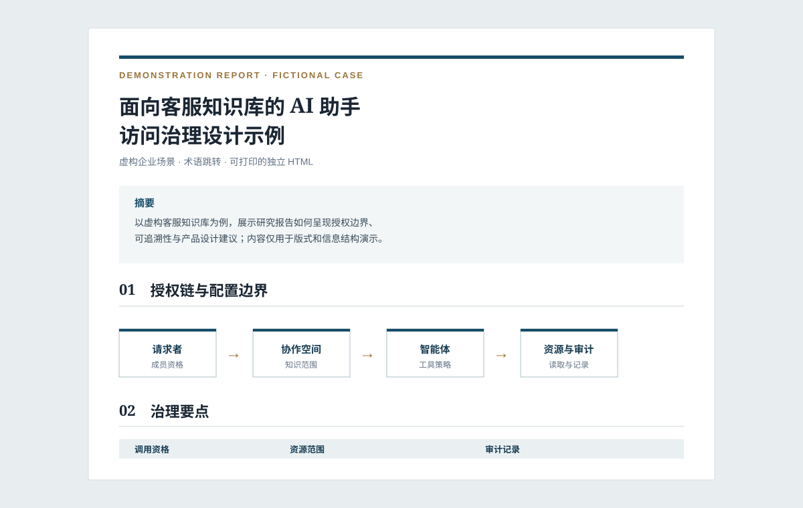

# 专业研究报告 HTML Skill

将研究主题、现有草稿或一组资料，转化为可直接打开的中文专业期刊风格 HTML 报告。

它适合产品研究、技术研究、行业分析、市场研究和政策研究等需要兼顾内容核验、学术表达与阅读体验的任务。最终文件面向桌面阅读和 A4 打印，无需构建工具或外部运行环境。

技能的可移植核心是根目录的 `SKILL.md` 与 `references/`。其目录结构遵循 [Agent Skills](https://agentskills.io) 约定，可供支持该约定的 Agent 加载；`agents/openai.yaml` 只为 Codex 提供界面展示信息，其他环境可忽略。

## 效果预览

下方为技能生成的完整示例。它使用虚构的企业客服知识库场景，仅用于展示论文结构、表格、机制图、术语跳转、编号引文和打印版式；其中的机构、资料和数字均不对应真实项目或研究结论。

<p align="center">
  <a href="examples/customer-service-agent-demo.html">
    
  </a>
</p>

<p align="center"><a href="examples/customer-service-agent-demo.html">打开完整演示报告</a> · <a href="examples/README.md">查看示例说明</a></p>

这个呈现方式借鉴了开源技能仓库中“README 负责快速理解、独立示例文件负责完整复现”的做法：预览图降低首次阅读成本，完整 HTML 则让读者核对交付质量而无需安装或运行 Agent。

## 能力

- 核验资料来源、链接、发布日期和产品状态，优先采用官方文档、原始研究与一手公告。
- 将口语化或工作笔记式材料重构为克制、可归因的学术中文。
- 区分已发布能力、规划能力、案例实践与作者分析，避免把推测写成事实。
- 组织题目、摘要、关键词、背景、分析框架、主体分析、风险与局限、对比、启示、结论、术语表和参考文献等论文结构。
- 生成表格、机制图或架构图，并以图注说明其来源或分析属性。
- 为术语提供首次出现时的简释；正文中的术语可跳转至文末术语表。
- 建立就近编号引文与可追溯的参考文献。
- 使用语义化 HTML 和内嵌 CSS，实现桌面、移动端及 A4 打印阅读。
- 提供零依赖 HTML 交付验证器，检查文档结构、内部锚点和常见的非自包含资源。

## 使用方式

在支持 Codex Skills 的环境中直接调用：

```text
使用 $professional-research-html，将“某个主题”的研究资料整理为中文专业期刊风格 HTML 文件，并核验来源与日期。
```

也可以给出已有草稿、参考链接、目标读者、语言要求和版式偏好。例如：

```text
使用 $professional-research-html，将这份访谈纪要和五篇官方资料整理为一份面向企业管理者的研究报告。重点分析产品机制，术语要能跳转至释义，输出适合 A4 打印的 HTML。
```

## 跨 Agent 安装

完整步骤见 [INSTALL.md](INSTALL.md)。下表说明常见环境的加载位置和调用方式；不同版本的产品可能调整目录或命令，应以各产品当期文档为准。

| 环境 | 推荐安装位置 | 调用方式 |
|---|---|---|
| Codex | `$CODEX_HOME/skills/professional-research-html` | 在提示中引用 `$professional-research-html`，或直接描述任务。 |
| Claude Code / Claude | 该环境配置的 Skills 目录 | 以技能名或自然语言任务调用；Claude Skills 使用同一 `SKILL.md` 为入口。 |
| Qoder CLI | `~/.qoder/skills/professional-research-html`，或项目内 `.qoder/skills/professional-research-html` | 安装后执行 `/skills reload`，再按名称或自然语言调用。 |
| QoderWork | `~/.qoderwork/skills/professional-research-html` | 通过其 Skills 管理界面或本地目录加载后调用。 |
| WorkBuddy | 导入一个根目录含 `SKILL.md` 的 ZIP 包 | 在 Skills 管理界面导入本仓库生成的 ZIP 包。 |

可先克隆仓库，再将整个目录复制到对应技能目录：

```bash
git clone <repository-url>
```

对于需要 ZIP 导入的环境，可在仓库根目录执行：

```bash
scripts/package-skill.sh
```

该命令生成 `dist/professional-research-html.zip`；压缩包内部直接以 `SKILL.md` 为根文件，适合要求此结构的导入器。

### 兼容性边界

- `SKILL.md`、`references/` 与生成逻辑中的通用写作要求可跨 Agent 使用。
- `agents/openai.yaml` 仅改善 Codex 的显示名称、简介和默认提示，不影响其他环境执行。
- 每个 Agent 的联网、文件访问、浏览器和外部工具权限不同；研究、核验与文件写入仍应使用目标环境提供的工具并遵循其权限模型。
- 本仓库不绑定某一家模型或检索服务。来源核验、脚注、术语链接和 HTML 排版规则均可在具备对应能力的环境中执行。

相关平台文档：[Claude Skills](https://claude.com/resources/guides/the-complete-guide-to-building-skills-for-claude/fundamentals)、[Qoder CLI Skills](https://docs.qoder.com/cli/Skills)、[QoderWork Skills](https://docs.qoder.com/qoderwork/skills)。

## 工作流程

1. 建立证据清单：记录每项论点、来源、日期、状态与引用标识。
2. 核验可变化的事实，缩小不被一手资料支持的断言。
3. 以论文结构重写，并将来源陈述、综合判断和建议分开。
4. 生成自包含 HTML，加入表格、图示、术语表、引文和打印样式。
5. 检查锚点、参考文献、术语跳转、移动端布局和打印效果。

交付前可执行以下命令进行结构验证；脚本仅依赖 Python 标准库：

```bash
python3 scripts/validate_html_report.py /path/to/report.html
```

## 文件结构

```text
.
├── SKILL.md                         # 技能入口与交付规则
├── README.md
├── INSTALL.md
├── agents/openai.yaml               # Codex 界面元数据
├── assets/
│   └── customer-service-agent-preview.svg  # README 示例预览图
├── examples/
│   ├── README.md                     # 示例范围与隐私说明
│   └── customer-service-agent-demo.html    # 可直接打开的虚构演示报告
├── scripts/
│   ├── package-skill.sh              # 生成根含 SKILL.md 的导入 ZIP
│   └── validate_html_report.py       # 验证 HTML 交付结构
└── references/
    └── workflow-and-layout.md       # 证据、写作、引用、术语与版式规范
```

## 设计边界

本技能帮助生成结构规范、来源可追溯的研究报告，不替代同行评审、专业法律意见、医学建议或其他需具备专业资质的审查流程。动态文档若无法核验发布日期，会记录访问日期而不虚构日期。

## 验证

```bash
python3 /path/to/skill-creator/scripts/quick_validate.py /path/to/professional-research-html
```

本技能由 `skill-creator` 的验证器检查过元数据与文件结构。
